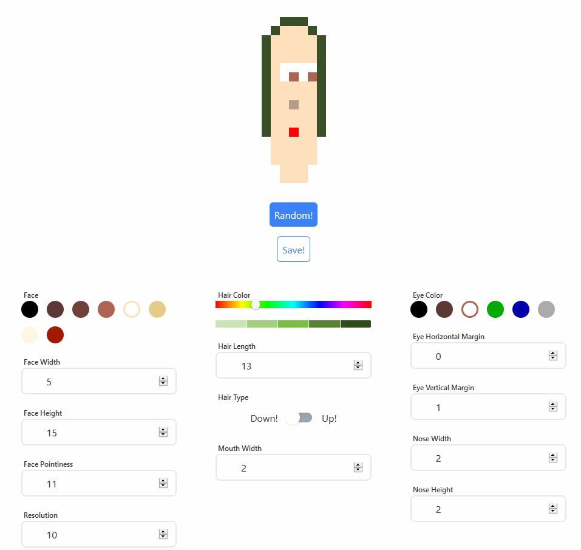

# Gerador de caras

Página standalone para gerar caras pixeladas e salvar o resultado em SVG.

## Como usar

Abra `index.html` diretamente no navegador. Não é necessário instalar nada nem
rodar um servidor.

Os arquivos da página são:

- `index.html` — estrutura da página
- `style.css` — estilos
- `script.js` — lógica dos controles e exportação
- `pixel-face.js` — cópia local da biblioteca
  [pixel-face](https://github.com/CGReinhold/pixel-face), usada para desenhar as caras
